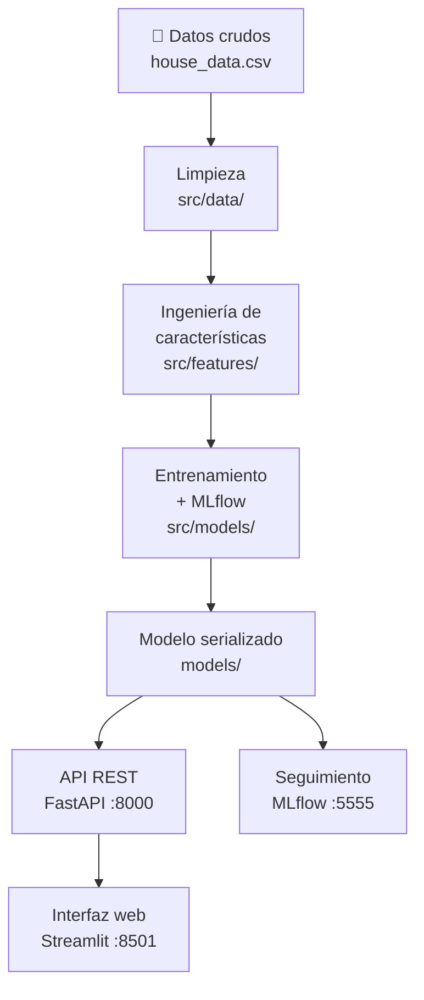

# 🏠 Predictor de Precios de Casas — Proyecto MLOps

> **Módulo:** 18 — MLOps · **Dificultad:** 🔴 Avanzado  
> 📄 [README del módulo](../../README.md) · ← [T16-5 — Testing](../../T16%20-%205%20-%20MLOps%20-%20Testing%20de%20Pipelines%20ML.ipynb)

| | |
|---|---|
| **Tipo** | Proyecto integrador de MLOps de extremo a extremo |
| **Dificultad** | 🔴 Avanzado |
| **Tecnologías** | Python, MLflow, FastAPI, Streamlit, Docker, Kubernetes |
| **Prerequisitos** | M12 (Pipelines sklearn) · M15 (XGBoost) · T16-1 al T16-5 |

---

## ¿Qué aprenderás?

- Construir un **pipeline ML completo** desde datos crudos hasta predicción en producción
- Rastrear experimentos y versionar modelos con **MLflow**
- Exponer el modelo como **API REST** con FastAPI
- Construir una **interfaz web interactiva** con Streamlit
- Empaquetar y orquestar todo con **Docker Compose**
- Desplegar en un clúster **Kubernetes** (carpeta )

## ¿Por qué?

Este proyecto simula un caso real de negocio: una inmobiliaria necesita predecir precios de casas de forma automatizada. Cubre el ciclo completo — desde la ingeniería de datos hasta el despliegue en producción — usando las mismas herramientas que se usan en equipos de ML profesionales.

---

## Notebooks del proyecto

| Notebook | Contenido |
|----------|-----------|
|  | Carga, limpieza y validación del dataset de casas |
|  | Análisis exploratorio: distribuciones, correlaciones, valores atípicos |
|  | Transformaciones, codificación de variables y construcción del pipeline de preprocesado |
|  | Entrenamiento de modelos con seguimiento en MLflow |

---

## Estructura del proyecto

```
house-price-predictor/
├── configs/              # Configuración de modelos en formato YAML
├── data/                 # Datasets crudos y procesados
├── deployment/
│   └── mlflow/           # Docker Compose para levantar el servidor MLflow
├── models/               # Modelos entrenados y preprocesadores serializados
├── notebooks/            # Notebooks de exploración y experimentación
├── src/
│   ├── api/              # API REST con FastAPI
│   ├── data/             # Scripts de limpieza y preprocesado
│   ├── features/         # Pipeline de ingeniería de características
│   └── models/           # Entrenamiento y evaluación de modelos
├── streamlit_app/        # Interfaz web interactiva
├── Dockerfile            # Imagen Docker de la API
├── docker-compose.yaml   # Orquestación de todos los servicios
└── requirements.txt      # Dependencias Python
```

---

## Flujo del proyecto



---

## Configuración del entorno

Herramientas necesarias:
- [Python 3.11](https://www.python.org/downloads/)
- [Git](https://git-scm.com/)
- [UV — Gestor de entornos Python](https://github.com/astral-sh/uv)
- [Docker Desktop](https://www.docker.com/products/docker-desktop/) **o** [Podman Desktop](https://podman-desktop.io/)

### Instalar las herramientas

**Linux (Ubuntu/Debian):**

```bash
sudo apt update && sudo apt install -y git python3.11 python3.11-venv curl
curl -LsSf https://astral.sh/uv/install.sh | sh
curl -fsSL https://get.docker.com | sudo sh
sudo usermod -aG docker $USER    # cierra sesión y vuelve a entrar
```

**Windows 10/11 (PowerShell):**

```powershell
winget install -e --id Git.Git
winget install -e --id Python.Python.3.11
winget install -e --id astral-sh.uv
winget install -e --id Docker.DockerDesktop     # requiere WSL2: wsl --install
```

### Crear el entorno

**Linux / macOS:**

```bash
# 1. Clonar el repositorio
git clone https://github.com/<tu-usuario>/house-price-predictor.git
cd house-price-predictor

# 2. Crear entorno virtual con UV
uv venv --python python3.11
source .venv/bin/activate

# 3. Instalar dependencias
uv pip install -r requirements.txt
```

**Windows (PowerShell):**

```powershell
# 1. Clonar el repositorio
git clone https://github.com/<tu-usuario>/house-price-predictor.git
cd house-price-predictor

# 2. Crear entorno virtual con UV
uv venv --python 3.11
.\.venv\Scripts\Activate.ps1

# 3. Instalar dependencias
uv pip install -r requirements.txt
```

> En `cmd.exe`: `.venv\Scripts\activate.bat`.
> Si PowerShell bloquea el script: `Set-ExecutionPolicy RemoteSigned -Scope CurrentUser`.

### Verificar

```bash
python --version          # Python 3.11.x
uv --version
docker compose version
```

---

## Levantar MLflow para seguimiento de experimentos

```bash
cd deployment/mlflow
docker compose -f mlflow-docker-compose.yml up -d
```

Accede a la interfaz de MLflow en [http://localhost:5555](http://localhost:5555)

---

## Flujo de trabajo paso a paso

### Paso 1 — Procesado de datos 2026

```bash
python src/data/run_processing.py   --input data/raw/house_data.csv   --output data/processed/cleaned_house_data.csv
```

### Paso 2 — Ingeniería de características

```bash
python src/features/engineer.py   --input data/processed/cleaned_house_data.csv   --output data/processed/featured_house_data.csv   --preprocessor models/trained/preprocessor.pkl
```

### Paso 3 — Entrenamiento con seguimiento MLflow

```bash
python src/models/train_model.py   --config configs/model_config.yaml   --data data/processed/featured_house_data.csv   --models-dir models   --mlflow-tracking-uri http://localhost:5555
```

---

## Construcción y despliegue con Docker

```bash
# Construir y lanzar la API (FastAPI) + interfaz (Streamlit)
docker compose up --build

# Verificar que los servicios están activos
docker compose ps
```

- **API FastAPI**: [http://localhost:8000](http://localhost:8000)
- **Interfaz Streamlit**: [http://localhost:8501](http://localhost:8501)

### Probar la API directamente

**Linux / macOS (curl):**

```bash
curl -X POST "http://localhost:8000/predict" \
  -H "Content-Type: application/json" \
  -d '{
    "sqft": 1500,
    "bedrooms": 3,
    "bathrooms": 2,
    "location": "suburban",
    "year_built": 2000,
    "condition": "fair"
  }'
```

**Windows (PowerShell):**

```powershell
$body = @{
    sqft       = 1500
    bedrooms   = 3
    bathrooms  = 2
    location   = "suburban"
    year_built = 2000
    condition  = "fair"
} | ConvertTo-Json

Invoke-RestMethod -Uri "http://localhost:8000/predict" -Method Post `
  -ContentType "application/json" -Body $body
```

> `curl` en PowerShell es un alias de `Invoke-WebRequest` y no acepta las mismas opciones.
> Si prefieres el `curl` real, usa `curl.exe` o ejecútalo desde Git Bash / WSL.

### Problemas frecuentes

| Síntoma | Sistema | Solución |
|---|---|---|
| `docker: error during connect` | Windows | Abre Docker Desktop y espera a que el motor arranque |
| `permission denied ... docker.sock` | Linux | `sudo usermod -aG docker $USER` y reinicia la sesión |
| Puertos 8000/8501/5555 ocupados | Ambos | Cambia el mapeo en `docker-compose.yml` (`8001:8000`) |
| Los scripts `.sh` fallan en el contenedor | Windows | `git config --global core.autocrlf input` y reconstruye |
| `uv: command not found` | Ambos | Reabre la terminal tras instalar UV (actualiza el `PATH`) |

---

## Despliegue en Kubernetes

El directorio  contiene los manifiestos YAML para desplegar toda la aplicación en un clúster Kubernetes:

| Carpeta | Qué despliega |
|---------|--------------|
|  | Pods básicos de la aplicación |
|  | Reglas de enrutamiento externo |
|  | Prometheus + Grafana |
|  | Políticas de red y servicios |
|  | Volúmenes persistentes |
|  | Panel de administración Kubernetes |

```bash
# Aplicar todos los manifiestos
kubectl apply -f k8s-code/projects/
kubectl get pods
kubectl get services
```

### Instalar kubectl y un clúster local

**Linux:**

```bash
sudo snap install kubectl --classic
sudo snap install minikube
minikube start --driver=docker
```

**Windows (PowerShell):**

```powershell
winget install -e --id Kubernetes.kubectl
winget install -e --id Kubernetes.minikube
minikube start --driver=docker
```

> Alternativa en Windows: activa **Enable Kubernetes** en Docker Desktop → *Settings → Kubernetes*.

Acceder a los servicios desplegados:

```bash
kubectl port-forward svc/house-price-api 8000:8000
```

---

← [README del Módulo 18](../../README.md)
